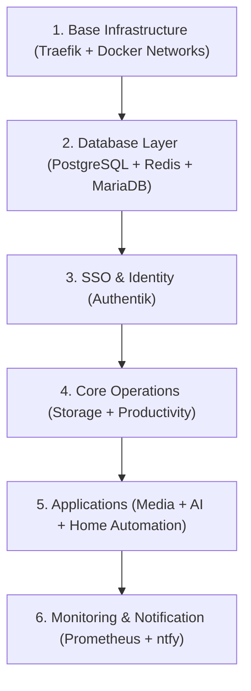

# 🚨 Disaster Recovery (DR) Plan — 灾难恢复演练手册

本手册详细阐述在底层宿主机彻底损坏、机房断电或数据毁损时，如何从零在新主机上基于 3-2-1 备份方案完成系统的完整恢复。

---

## ⏱️ 关键指标 (SLA / RTO)

| 指标 | 目标值 | 说明 |
| :--- | :--- | :--- |
| **RTO (恢复时间目标)** | **< 30 分钟** | 从全新 Linux 主机装机到全部服务恢复上线 |
| **RPO (数据恢复点目标)** | **< 24 小时** | 每日凌晨 02:00 自动执行全量备份 |

---

## 🔄 服务恢复黄金顺序 (Service Sequence)

必须严格按照系统依赖拓扑顺序分级启动，禁止无序并行拉起：



---

## 🛠️ 全新主机恢复四步法 (Step-by-Step)

### 第 1 步：环境初始化与前置准备
在一台全新安装 Ubuntu/Debian 的服务器上：
```bash
# 1. 安装基础工具与 Docker Engine
curl -fsSL https://get.docker.com | sh
sudo usermod -aG docker $USER

# 2. 克隆项目或准备目录结构
sudo mkdir -p /opt/homelab
cd /opt/homelab
git clone https://github.com/illbnm/homelab-stack.git .
```

### 第 2 步：拉取并恢复备份档案
从异地备份源（S3/MinIO、Backblaze B2 或本地外部介质）获取最新备份文件：
```bash
# 列出备份
./scripts/backup.sh --list

# 检验备份完整性 (CRC32/tar archive check)
./scripts/backup.sh --verify

# 恢复全量配置与数据卷
./scripts/backup.sh --restore backup_all_YYYYMMDD_HHMMSS.tar.gz
```

### 第 3 步：按序恢复各 Stack 容器
```bash
# 1. 恢复网络与基础代理网关
docker network create homelab-internal || true
docker network create proxy || true
cd stacks/base && docker compose up -d

# 2. 恢复数据库层并导入数据
cd ../databases && docker compose up -d
# 等待数据库健康检查通过
docker compose ps

# 3. 恢复认证中心
cd ../sso && docker compose up -d

# 4. 恢复其余业务
cd ../productivity && docker compose up -d
cd ../storage && docker compose up -d
cd ../notifications && docker compose up -d
```

### 第 4 步：恢复完整性核验清单 (Checklist)

- [ ] Traefik Dashboard 与 Let's Encrypt 证书重新签发正常
- [ ] PostgreSQL 数据库中 `nextcloud`, `gitea`, `outline` 数据表完好无损
- [ ] Authentik SSO 单点登录流程畅通
- [ ] ntfy / Gotify 收到 "System Disaster Recovery Succeeded" 恢复完成告警
